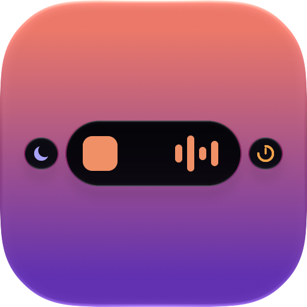

<p align="center">
  
</p>

<h1 align="center">Notchi</h1>

<p align="center">A Dynamic Island for the Mac.</p>

On a notched MacBook display, Notchi grows out of the camera notch. On a main display without a notch, it floats as an island capsule. Live activities show beside the notch, and hovering opens a Liquid Glass panel with more. See [docs/ARCHITECTURE.md](docs/ARCHITECTURE.md) for the design.

## Features

- **Live activities, stacked.** The main activity sits in the notch; up to two more float beside it as detached bubbles. Click a bubble to swap it into the middle with a warp, like the iPhone's Dynamic Island.
- **Now Playing.** Music, Spotify, Podcasts and other music apps (browsers and video apps optional): artwork, a real audio visualizer, progress with seeking, and transport controls.
- **Calls.** FaceTime, Phone, Zoom, Teams, Slack, Discord and calls in a browser: a green phone (a camera for video) and the call's running time. Open the notch to mute the microphone for every app or jump to the call. A ringing FaceTime or iPhone call takes the middle with the caller's name, and the open notch answers or declines it, like the iPhone. "Ended" shows when it's over.
- **Recording.** While the screen is recorded or shared, a pulsing red dot and the time; a ⇧⌘5 recording can be stopped from the notch. Apps recording audio, like Voice Memos, show an orange microphone.
- **Clock timers.** Running and paused timers and the stopwatch from Apple's Clock app, with a "Done" toast when a timer ends.
- **Volume and brightness HUD.** Replaces the system's, in the notch's own row: icon and percentage on the left, the level bar on the right.
- **Battery.** Charging and low-battery toasts with a battery drawn to its real level.
- **Focus.** Turning a Focus on or off is announced in the notch, with its symbol and name.
- **Shelf.** Drag files, images, links or text onto the notch to keep them for later, then drag them back out. Or drop them on Share for AirDrop, Messages, Mail and more.
- **Coding agents.** Claude Code, Codex and Gemini CLI at work, each running session as its own live activity with the agent's own mascot: Clawd from Claude.app, your Codex pet from the Codex app. See what each is doing ("Editing NotchShape.swift"), its plan's progress and how long the request has run. The glass can take on the agent's color. An agent that needs your permission takes the middle; a finished request says "Done". Works with no setup; optional hooks (Settings › Agents) make the steps exact and instant.
- **Your look.** Glass style and clarity, corner radius, top curve, notch blend, open animation, and live activity and panel widths, all applying live. Toasts reopen the notch as they take over.

## Requirements

- macOS 14 or later, Apple Silicon
- Xcode 26 or later to build (the app icon is an Icon Composer document); developed with Xcode 27.1

## Install

1. Download `Notchi-<version>.dmg` from the [latest release](https://github.com/buflplayz/notchi/releases/latest).
2. Open the DMG and drag **Notchi** onto the **Applications** folder.
3. Eject the disk image and open Notchi from Applications or Launchpad.

If macOS says Notchi can't be opened because it couldn't check it for malicious software, go to System Settings › Privacy & Security and click **Open Anyway**. This happens with builds that aren't notarized.

To uninstall, quit Notchi (right-click the notch › Quit) and move it from Applications to the Trash.

## Build and run

Open `Notchi.xcodeproj` in Xcode and press ⌘R. Or from a terminal:

```bash
xcodebuild -project Notchi.xcodeproj -scheme Notchi build
```

```bash
open ~/Library/Developer/Xcode/DerivedData/Notchi-*/Build/Products/Debug/Notchi.app
```

The project is signed with an Apple Development identity, so macOS permissions survive rebuilds. To build on another machine, set your own team under Signing & Capabilities.

Keep build output out of iCloud-synced folders such as `~/Documents`. iCloud adds file attributes that make `codesign` fail with "resource fork, Finder information, or similar detritus not allowed". Xcode's default DerivedData location is fine.

## Make the DMG

```bash
scripts/make-dmg.sh
```

This builds Release and writes `build/Notchi-<version>.dmg`, holding `Notchi.app`, an `Applications` shortcut to drag it onto, and the license. The version comes from `MARKETING_VERSION`.

- By default it signs with the project's Apple Development identity. That's fine for your own Macs.
- For a public release, sign with Developer ID and notarize, so it opens without Gatekeeper warnings:

  ```bash
  xcrun notarytool store-credentials notchi-notary   # once: Apple ID, team, app-specific password
  scripts/make-dmg.sh --identity "Developer ID Application: Your Name (TEAMID)" --notarize notchi-notary
  ```

- With no Apple Developer account, use `--adhoc`. The hardened runtime is off then, and other Macs need **Open Anyway**.

Run `scripts/make-dmg.sh --help` for every option.

### Releases

[`.github/workflows/release.yml`](.github/workflows/release.yml) builds the DMG on GitHub and publishes it, so it becomes the download in [Install](#install). Bump `MARKETING_VERSION`, then push a matching tag:

```bash
git tag v0.1.0 && git push origin v0.1.0
```

The workflow fails if the tag and the version differ.

No terminal handy (on a phone, say)? Open the **Actions** tab, pick **Release** and tap **Run workflow**. It publishes release `v<MARKETING_VERSION>` and creates the tag. Untick **Publish a release** to only build a DMG you can download from the run.

With no secrets set, release DMGs are signed ad hoc. To sign with Developer ID and notarize, add the repository secrets listed at the top of the workflow: the certificate as a base64 `.p12` and its password, plus an App Store Connect API key for notarization.

## Using Notchi

- **Open:** hover over the notch, or click it (Settings › General can make it click-only).
- **Swap activities:** click a bubble beside the notch.
- **Keep a file:** drag it onto the notch and drop it on **Shelf**. Drag it out of the Shelf tab when you need it.
- **Settings and Quit:** right-click the notch, or use the **⋯** menu in the open panel. Notchi has no Dock icon or menu bar item.

### Permissions

Notchi asks only when a feature needs it.

| Permission | Used for |
|---|---|
| Accessibility | Replacing the volume and brightness HUD (the media keys), seeing which Focus is on (the menu bar's Focus item), incoming calls (Notification Center's call alert), and stopping a screen recording |
| System Audio Recording | The real audio visualizer, only while music plays. Audio is analyzed live, never recorded. |
| Automation (Music, Spotify) | Controls and artwork, only if the system Now Playing service isn't available |

## Test

```bash
xcodebuild -project Notchi.xcodeproj -scheme Notchi test
```

## Debug helpers (Debug builds only)

- `-NotchiForceIsland YES` shows the island style even on a notched display. It's a disabled launch argument in the scheme; tick it under Product › Scheme › Edit Scheme › Arguments.
- Drive Notchi from a terminal by posting a distributed notification named `dev.notchi.debug`:

  ```bash
  swift -e 'import Foundation; DistributedNotificationCenter.default().postNotificationName(.init("dev.notchi.debug"), object: "expand", userInfo: nil, deliverImmediately: true)'
  ```

  | Object | Does |
  |---|---|
  | `expand`, `collapse` | Opens or closes the panel |
  | `show:<module>` | Opens a module's page (`media`, `clock`, `agents`, `shelf`, `system`) |
  | `swap:<module>` | Clicks that module's bubble beside the notch |
  | `hud:volume:0.6`, `hud:brightness:0.3`, `hud:mute` | Shows the HUD without pressing keys |
  | `hud:charging:0.76`, `hud:low:0.1` | Shows a battery toast |
  | `focus:<name>`, `focus:off` | Pretends a Focus turned on or off |
  | `call:incoming:<name>`, `call:active:<bundle id>`, `call:end` | Fakes a ringing call, a call in an app (default FaceTime), or ends it |
  | `rec:screen`, `rec:audio`, `rec:off` | Fakes a screen recording or an app recording audio, or stops the fakes |
  | `callDump` | Writes Notification Center's windows to `$TMPDIR/notchi-call-dump.txt`, to see how a call's alert is built |
  | `agent:<claude\|codex\|gemini>:<state>`, `agent:clear` | Fakes an agent session (`working`, `thinking`, `plan`, `waiting`, `done`, `failed`), or removes the fakes |
  | `focusDump`, `focusTrace` | Writes what the Focus monitor sees (a snapshot, or a 40 s timed trace) to `$TMPDIR` |
  | `settings`, `settings:<tab>`, `closeSettings` | Opens Settings (at `general`, `modules`, a module's tab, or `about`), or closes it |
  | `audioTap` | Runs the visualizer's audio tap for 6 s and logs the result under subsystem `dev.notchi.Notchi` |

## Roadmap

- [x] Notch and island styles, animations, hover and click, Settings
- [x] Now Playing, Clock timers, volume and brightness HUD, battery, Focus
- [x] Stacked live activities with swappable bubbles
- [x] Shelf for dropped files
- [ ] Notchi's own stopwatch and timer
- [x] Coding agents: Claude Code, Codex and Gemini CLI, with their mascots
- [x] Calls (ongoing and incoming) and screen and audio recording
- [ ] AirPods and output-device toasts, clipboard

## License

Notchi is released under the [MIT License](LICENSE). © 2026 BuflPlayz.

It includes [mediaremote-adapter](https://github.com/ungive/mediaremote-adapter) by Jonas van den Berg and contributors, under the BSD 3-Clause License (see [Vendor/mediaremote-adapter/LICENSE](Vendor/mediaremote-adapter/LICENSE)).
